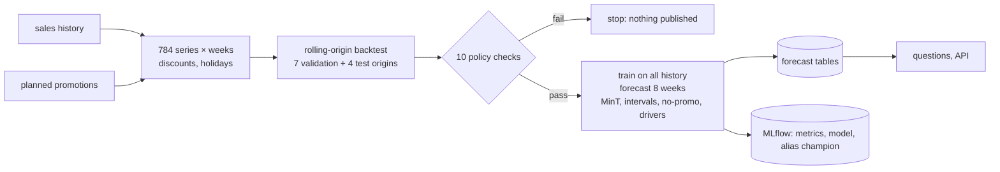

# Architecture

## Weekly run

## Training rows

For an origin T and horizon h, a row describes series i at week T + h using only what was
known at T: levels over the last 1 to 26 weeks, the same weeks last year, the calendar and
holiday flags for week T + h, and the discount planned for it. Values are divided by the
series' mean over the 52 weeks to T, so one model covers series from a few units to tens of
thousands a week. The target is the scaled value at T + h (Tweedie loss). Training uses every
second origin from week 56 to T − 8.

## Reconciliation

With base forecasts ŷ (784 × 8) and the summing matrix S (784 × 720):

- bottom-up: ỹ = S ŷ_bottom
- MinT: ỹ = S (Sᵀ W⁻¹ S)⁻¹ Sᵀ W⁻¹ ŷ, with W the Schäfer-Strimmer shrinkage estimate of the
  base forecast errors' covariance from the validation windows (56 observations × 784 series,
  so shrinkage is essential).

Negative reconciled values are clipped at the bottom level and summed up again, which keeps
coherence exact.

## Intervals

For each level, scaled errors (actual − forecast) / series scale from the validation windows
are pooled across horizons, and the 10% and 90% quantiles with the finite-sample correction
become the bounds. Coverage is then measured on the test windows.

## Promotion uplift and drivers

The published forecast is computed twice: once with the planned discounts and once with them
set to zero. The difference is the uplift. Drivers are LightGBM TreeSHAP contributions in the
model's (scaled) units, grouped as promotions, seasonality and holidays, and recent sales
level.
